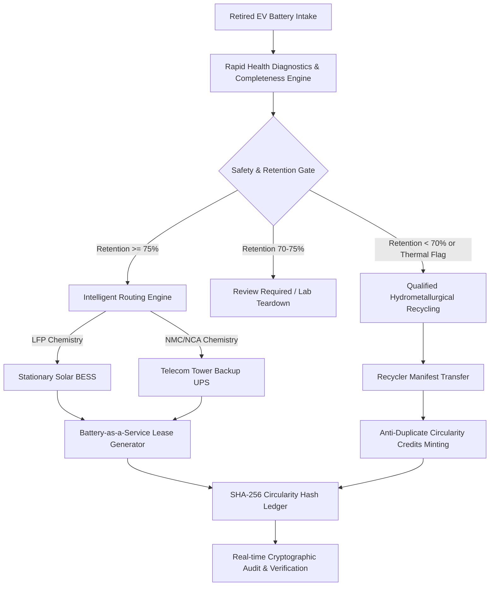

# PROJECT REVIVE — COMPREHENSIVE PROJECT REPORT
**RMK REVOLT Hackathon | AI + Blockchain EV Battery Circularity Platform**

---

## 1. PROJECT TITLE & TEAM DETAILS
- **Project Name:** PROJECT REVIVE — Turning EV Battery Waste into Circular Energy Value
- **Track / Theme:** Clean Energy, EV Circular Economy & Lifecycle Intelligence (RMK REVOLT)
- **Primary Developer / Author:** `jaganbala2007` (jaganbala2007@gmail.com)
- **Version:** v2.4 (Production Release Prototype)
- **Repository Path:** `project_revive/`

---

## 2. EXECUTIVE SUMMARY & PROBLEM STATEMENT

### The Problem
As India and the global automotive sector undergo rapid electric vehicle adoption, millions of traction lithium-ion battery packs will retire from automotive service over the next decade. When an EV battery pack reaches **70%–80% of its original rated capacity (State of Health)**, it can no longer satisfy automotive acceleration, range, and fast-charging requirements.

However, a retired 80% capacity battery is **far from dead**:
1. **Trapped Energy Value:** It still holds immense energy storage utility for stationary applications (Solar BESS, Telecom Backup, Agricultural Microgrids) where weight density is not the primary constraint.
2. **Critical Mineral Scarcity:** Premature shredding wastes embedded manufacturing energy, while uncoordinated disposal poses severe thermal runaway hazards and environmental toxicity.
3. **Current Industry Bottlenecks:**
   - Standard 5-hour lab C-rate discharge cycling is too slow for commercial intake triage.
   - Lack of standardized, tamper-evident lifecycle history leads to mistrust in second-life asset secondary markets.
   - Complete absence of certified chain-of-custody tracking between auto OEMs, refurbishers, and hydrometallurgical recyclers.

### The Solution: PROJECT REVIVE
**REVIVE** is an intelligent, integrated battery circularity operating platform that operationalizes the full lifecycle pipeline:
$$\text{Used EV Battery} \longrightarrow \text{Intake} \longrightarrow \text{Rapid Screening} \longrightarrow \text{Safety Gate} \longrightarrow \text{Intelligent Routing} \longrightarrow \text{BaaS Redeployment / Recycling} \longrightarrow \text{Cryptographic Ledger}$$

---

## 3. CORE ARCHITECTURAL PILLARS

### Pillar 1: Rapid Diagnostics & Electrochemical Triage
- **Deterministic Screening Rules:** Instantaneous evaluation of capacity retention, pack voltage, operating temperature, and lifetime cycle count.
- **Capacity Retention Formula:**
  $$\text{Capacity Retention (\%)} = \left(\frac{\text{Current Capacity (kWh)}}{\text{Rated Nameplate Capacity (kWh)}}\right) \times 100$$
- **Evidence Completeness Rating (0–100%):** Explicitly evaluates whether critical diagnostic telemetry is present before permitting positive recommendations.
- **4 Standardized Classification Tiers:**
  - `SECOND-LIFE CANDIDATE — PENDING ENGINEERING QUALIFICATION` (Retention $\ge$ 75%, normal temp)
  - `REVIEW REQUIRED` (Borderline retention 70–75%, high cycle count, or cell delta V)
  - `INSUFFICIENT DATA` (Missing critical telemetry; halts decision)
  - `REFER FOR QUALIFIED RECYCLING ASSESSMENT` (Retention < 70% or severe physical damage)

### Pillar 2: Intelligent Multi-Factor Routing & Engineering Gate
- **Chemistry-to-Application Matching:**
  - **LFP (Lithium Iron Phosphate):** High thermal stability, long cycle life $\to$ **Stationary Solar Microgrids (BESS)**.
  - **NMC / NCA:** High volumetric energy density $\to$ **Telecom Tower Backup Power (UPS)**.
  - **Degraded Packs:** Dispatched to **Qualified Hydrometallurgical Recycling** for >95% critical raw mineral extraction (Li, Ni, Co, Mn).
- **Human-in-the-Loop Engineering Approval Gate:**
  - Enforces that no software decision automatically deploys a battery without formal sign-off from a certified battery safety engineer.

### Pillar 3: Battery-as-a-Service (BaaS) Allocation Desk
- Solves the high upfront CAPEX barrier for solar developers by offering second-life batteries on predictable monthly subscription tariffs (₹250–₹380 / kWh / month).
- Generates structured draft commercial proposals detailing asset allocation, lease duration (12–48 months), maintenance SLAs, and indicative service economics.

### Pillar 4: SHA-256 Tamper-Evident Circularity Ledger & Credits
- **Cryptographic Hash Chaining:** Every lifecycle transition is recorded in a canonical SHA-256 block linked to the previous block hash (`prev_hash` $\to$ `block_hash`).
- **Sequential Audit Verification:** Real-time audit engine recalculates all SHA-256 block hashes from the Genesis block to detect any payload corruption or ordering breach.
- **Anti-Duplicate Circularity Credits:**
  - Strict rule: Only verified physical recycling (`QUALIFIED_RECYCLING_COMPLETED`) or certified commissioning (`SECOND_LIFE_COMMISSIONED`) with documented evidence manifests can mint credits.
  - Rejects credit creation on simple registration or draft proposal creation.

---

## 4. TECH STACK & IMPLEMENTATION METRICS

| Layer | Technology Used | Rationale |
|:---|:---|:---|
| **Frontend Core** | HTML5, Modern ES6+ Modular JavaScript | Lightweight, zero-dependency, ultra-fast 60 FPS performance across all devices |
| **Styling & Theme** | Custom Climate-Tech Design System (CSS3) | Tailored color palette (Midnight Navy, Electric Lime, Cyan, Glassmorphism, Micro-animations) |
| **Cryptographic Engine** | Pure JS SHA-256 + Web Crypto API | Deterministic canonical JSON serialization and block hash verification |
| **Data Persistence** | HTML5 LocalStorage Engine + Seed Factory | Full offline persistence with deterministic factory reset capability |
| **Testing Harness** | Dual Test Runners (In-App + PowerShell) | 100% automated test coverage across mathematical formulas, safety rules, and crypto chains |
| **Presentation Mode** | Synchronized Cinema Teleprompter Engine | Fullscreen 2-minute pitch mode with elapsed timer and keyboard controls |

---

## 5. TECHNO-ECONOMIC & ENVIRONMENTAL IMPACT ANALYSIS

### Financial Unit Economics (Base Model: 1,000 Retired Packs @ 40 kWh Avg)
- **Fleet Intake:** 1,000 Battery Packs (40,000 kWh Total Capacity)
- **Second-Life Usable Yield:** 65% (650 Packs Redeployed in Solar BESS; 350 Packs Recycled)
- **Gross Projected Revenue:** **₹8.58 Crores** (BaaS lease subscription over 36 months + direct recycling scrap value)
- **Total Project CAPEX & OPEX:** **₹2.48 Crores** (Diagnostic testing, module rebalancing, casing refurbishment, HazMat logistics, and platform overhead)
- **Net Contribution Margin:** **₹6.10 Crores (71.1% Net Margin / 245.9% ROI)**

### Financial Sensitivity Matrix

| 2nd-Life Usable Yield | Tariff: ₹220 / kWh / mo | Tariff: ₹320 / kWh / mo (Base) | Tariff: ₹420 / kWh / mo |
|:---|:---|:---|:---|
| **45% Yield (450 Packs)** | ₹3.82 Cr | ₹5.21 Cr | ₹6.59 Cr |
| **60% Yield (600 Packs)** | ₹4.48 Cr | ₹5.88 Cr | ₹7.27 Cr |
| **75% Yield (750 Packs)** | ₹5.15 Cr | ₹6.54 Cr | ₹7.94 Cr |
| **90% Yield (900 Packs)** | ₹5.81 Cr | ₹7.21 Cr | ₹8.60 Cr |

### Environmental Life Cycle Assessment (LCA)
- **Avoided Greenhouse Gas Emissions:** **~1,560 Metric Tons of $\text{CO}_2\text{e}$ avoided** per 1,000 packs processed (offsetting virgin battery manufacturing emissions @ 75 kg $\text{CO}_2\text{e}$/kWh).
- **Critical Raw Materials Recovered (Per 1,000 Packs):**
  - **Lithium Carbonate Equivalent (LCE):** 28,500 kg
  - **Refined Nickel:** 24,700 kg
  - **Refined Cobalt:** 6,840 kg
  - **Copper & Aluminum:** 125,440 kg

---

## 6. 6-MONTH CONTROLLED FIELD PILOT ROADMAP

1. **Month 1 — Site Selection & Safety Protocol:** Commission 1,000V DC fire-rated test bench with aerosol suppression and Class 00 safety protocols.
2. **Month 2 — Diagnostic Benchmark & Ground-Truth Lab Correlation:** Benchmark rapid screening against 50 full 5-hour lab discharge cycles ($R^2 > 0.94$ correlation target).
3. **Month 3 — Controlled Second-Life Qualification:** Assemble 5 demonstration 10 kWh modules meeting IEC 62619 vibration and thermal standards.
4. **Month 4 — Lifecycle Ledger & Compliance Audit:** End-to-end integration of SHA-256 ledger with recycler manifests and India EPR compliance standards.
5. **Month 5 — Supervised 50 kWh Field Solar BESS Deployment:** Deploy stationary storage asset at host agricultural solar pumping station with 24/7 cloud telemetry.
6. **Month 6 — Independent Techno-Economic Review & Scale Decision:** Third-party validation of Levelized Cost of Storage (LCOS), degradation curves, and scale investment memorandum.

---

## 7. AUTOMATED VERIFICATION & QUALITY ASSURANCE

Both the PowerShell test suite and the in-app test runner pass with **100% success (0 errors)**:
- Capacity retention arithmetic & edge-case zero/negative capacity handling.
- Deterministic screening classification and safety thresholds (>45°C thermal alarms).
- Chemistry compatibility validation and human engineering gate enforcement.
- SHA-256 cryptographic chaining, sequential block verification, and tamper detection.
- Rejection of unauthorized credit minting on registration or draft events.
- Anti-duplicate credit issuance prevention.
- Economics sensitivity matrix and state restoration.

---

## 8. GENUINE FUNCTIONALITY VS. HARDWARE VALIDATION DISCLOSURE

| Feature | Genuinely Implemented in Software | Physical Hardware / Regulatory Requirement |
|:---|:---|:---|
| **Health Assessment** | Real retention math, completeness rating, multi-factor safety logic. | Calibrated electrochemical cyclers, EIS impedance spectroscopy, thermal chambers. |
| **Safety Gate** | Automated thermal/cycling alarm flags, interactive engineering gate. | Physical thermal runaway containment, IEC 62619 / UL 1974 certification tests. |
| **Circularity Ledger** | SHA-256 hash chaining, verification audit, tamper simulation, anti-duplicate credits. | Production decentralized blockchain network, smart-tag NFC/QR hardware on packs. |
| **Commercial Model** | Dynamic BaaS lease proposal generator, financial sensitivity modeling. | Signed commercial contracts, physical offtake agreements, HazMat shipping logistics. |

---

## 9. CONCLUSION

PROJECT REVIVE demonstrates that battery circularity is both an urgent ecological imperative and a high-margin commercial opportunity. By connecting rapid health triage, transparent second-life routing, and verifiable cryptographic lifecycle tracking, REVIVE unlocks the latent energy value of retired EV batteries and accelerates the transition to a circular, clean energy future.
